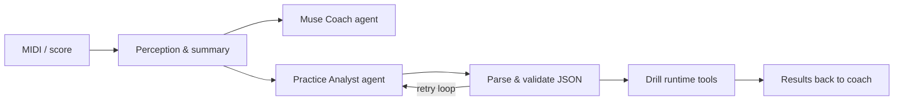

<p align="center">
  
</p>

<h1 align="center">Piano Muse</h1>

<p align="center">
  <strong>Inspire like a muse. Guide like a coach.</strong><br/>
  AI-agent harness for Android piano practice · Bluetooth MIDI · waterfall roll · layered drills
</p>

<p align="center">
  <em>钢琴陪练 · 钢琴教学助手 · AI 钢琴教练 · Harness Engineering · Multi-agent workflow</em>
</p>

<p align="center">
  <a href="https://github.com/Jianjian24">@Jianjian24</a>
</p>

---

## English

**Piano Muse** (`piano-muse`) is a long-term **open-source** Android app for learners who search for **piano practice companion**, **piano coaching**, **AI piano tutor**, and **piano teaching assistant** tools—and for developers interested in **LLM harness engineering** and **agent workflows** on device.

- **Muse** — spark practice ideas and musical intuition from your real playing (structured context, not hype).
- **Coach** — concrete next steps: chat feedback, drill review, and AI-generated **practice plans** (familiar → tackle → connect).

### Features

| Tab | What it does |
|-----|----------------|
| **Studio** | Bluetooth / system MIDI keyboard connect |
| **Muse** | LLM coach chat on a **60s practice summary**; idle hint after 2s |
| **Play** | Waterfall roll (hands color-coded), optional fingering hints, import `.mid` / `.mxl`, SoundFont preview, hold-to-pass drill |
| **Settings** | API key, base URL, model, skill level (local DataStore) |

### Agent harness (why this repo is “agent-first”)

**Agent = Model + Harness.** This is not a chat box on MIDI: the model plans and talks; Kotlin owns perception, tools, validation, and loops. Model “persona” lives in code (`CoachAgent.buildSystemPrompt`, `PiecePracticeAnalyzer` prompts)—not in a separate `AGENTS.md` file.



| Agent (role) | Code | Input | Output |
|--------------|------|-------|--------|
| **Muse Coach** | `coach.CoachAgent` | Practice summary JSON | Streaming coach reply |
| **Practice Analyst** | `coach.PiecePracticeAnalyzer` | Encoded piece | `PracticePlan` JSON |

Both use `ChatCompletionsClient` with **different prompts**; `MainViewModel` orchestrates—**multi-agent workflow**, not one mega-prompt.

**Harness layers:** (1) Perception — `session`, `PracticeContextBuilder`, `MidiPieceEncoder` (2) LLM — user-configured endpoint (3) Validation — ticks, three plan layers (4) **Repair loop** — up to 3 parse retries (5) Tools — drill engine, waterfall, fingering rules (6) Feedback — drill results back to Coach.

**Deterministic skills (no LLM):** BLE/system MIDI, MusicXML/MIDI import, waterfall drill, rule-based fingering hints.

**Privacy:** coaching sends **short summaries**, not raw high-frequency MIDI logs.

**Models:** any **OpenAI-compatible** Chat Completions endpoint; factory default DeepSeek is optional.

### Dev setup

1. Android Studio → open repo → Gradle sync  
2. Run on a **physical device** (MIDI + BLE)  
3. Optional: `secrets.properties` from `secrets.properties.example` (never commit keys)

### LLM API (OpenAI-compatible)

Muse and the practice-plan Analyst call `{baseUrl}/chat/completions` with `Authorization: Bearer <API Key>`—the same shape as **OpenAI**, **DeepSeek**, and most **relay / aggregator** gateways (One-API, New API, etc.). You choose all three fields in **Muse → Settings**:

| Field | Meaning |
|-------|---------|
| **API Key** | Your provider or proxy token |
| **Base URL** | API root (no trailing path); e.g. `https://api.openai.com/v1` or `https://api.deepseek.com` |
| **模型 / Model** | Provider model id, e.g. `gpt-4o-mini`, `deepseek-chat` |

**Shipped defaults** (optional starting point): DeepSeek `https://api.deepseek.com` + `deepseek-chat`. Replace with OpenAI or your relay if you prefer.

1. Obtain a key from your provider  
2. Enter Key, Base URL, and model in Settings → **保存** → **测试连接**  
3. Use a model that follows chat-completions JSON (streaming is not required; the app uses non-streaming HTTP)

Do **not** commit API keys. Prefer a backend proxy for public APKs.

### Build

```bash
./gradlew assembleDebug
adb install -r app/build/outputs/apk/debug/app-debug.apk
```

### Architecture

| Package | Role |
|---------|------|
| `midi` | BLE / system MIDI |
| `session` | Note ring buffer, idle detection |
| `coach` | Agents, OpenAI-compatible HTTP client, summaries |
| `drill` | Songs, drill engine, fingering, import |
| `settings` | DataStore |

---

## 中文

**Piano Muse（缪斯）** 是一款长期维护的 **开源** Android **钢琴陪练**应用：连接电钢琴采集演奏，用 **AI Agent Harness** 做陪练对话、分层练习与瀑布跟练。适合搜索 **钢琴教学**、**钢琴陪练**、**AI 钢琴** 的学习者，以及关注 **大模型 Harness / Agent 工程化** 的开发者。

### 产品气质

- **Muse（缪斯）**：从真实弹奏中提炼上下文，激发练什么、怎么练的灵感。  
- **Coach（教练）**：可执行的引导—对话点评、跟练结果反馈、整曲 **AI 分层计划**（熟悉 → 攻克 → 串联）。

### 功能概要

与英文表相同：**Studio** 连接 · **Muse** 对话教练 · **Play** 瀑布跟练与曲谱导入 · **设置** 本地密钥与水平。

### Agent 与 Harness

**Agent = 大模型 + Harness**，不是 MIDI 套壳聊天。模型的「人设 / 身份」在源码里拼接（`CoachAgent`、`PiecePracticeAnalyzer` 的 system prompt），没有单独的 `AGENTS.md` 式灵魂文件—避免和架构文档或 SOUL 命名混淆。

**核心分工：** Model 负责理解与规划；Harness 负责感知、工具、校验与重试（练习计划 JSON 失败时 **带错误原因重试，最多 3 次**）。

**多 Agent 协作** = 专职角色 + 编排层，不是多机器人闲聊：

| 角色 | 代码 | 输入 | 输出 |
|------|------|------|------|
| **Muse Coach** | `CoachAgent` | 最近演奏摘要 JSON | 流式陪练回复 |
| **Practice Analyst** | `PiecePracticeAnalyzer` | 整曲编码 | 分层 `PracticePlan` |
| **Harness 工具** | `drill` / `midi` 等 | 谱面、MIDI | 跟练、瀑布、指法提示（不走 LLM） |

由 `MainViewModel` 串起数据契约，即本项目的 **multi-agent workflow**。

**Harness 层次：** 感知 → 大模型 → 校验 → 修复循环 → 工具执行 → 反馈回 Coach。  
**隐私：** 上传 **摘要**，不上传 raw 高频 MIDI。  
**不走 LLM 的 Skill：** 连接琴、导入曲谱、瀑布跟练、规则指法。

### 大模型 API（OpenAI 兼容）

陪练对话与 **AI 练习计划** 均请求 `{Base URL}/chat/completions`，协议与 **OpenAI / DeepSeek / 常见中转站** 一致。在 **Muse → 设置** 填写 **API Key、Base URL、模型** 即可切换厂商，不必使用 DeepSeek。

| 示例 | Base URL | 模型示例 |
|------|-----------|----------|
| 内置默认 | `https://api.deepseek.com` | `deepseek-chat` |
| OpenAI | `https://api.openai.com/v1` | `gpt-4o-mini` 等 |
| 中转 / 聚合 | 服务商文档给出的根地址 | 对应模型名 |

保存后点 **测试连接** 验证。需支持 Chat Completions  JSON 返回（本应用走非流式 HTTP）。

### 开发与构建

同上；曲谱支持 `.mid` / `.mxl`（MusicXML）。跟练判定时值与齐键，**不判定指法对错**（指法仅为提示）。

### 关键词

`piano-muse` · 钢琴陪练 · 钢琴教学 · AI 钢琴教练 · 钢琴练习助手 · MIDI · MusicXML · waterfall piano · LLM harness · agent harness · OpenAI compatible · Android

---

## License

[MIT](LICENSE)
