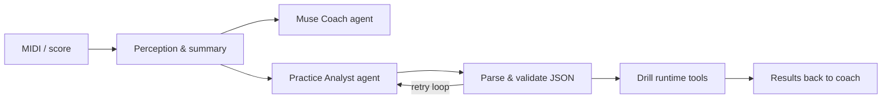

English | [中文](README_zh.md)

---

<p align="center">
  
</p>

<h1 align="center">Piano Muse</h1>

<p align="center">
  <strong>Inspire like a muse. Guide like a coach.</strong><br/>
  AI-agent harness for Android piano practice · Bluetooth MIDI · waterfall roll · layered drills
</p>

<p align="center">
  <em>钢琴陪练 · 钢琴教学助手 · AI 钢琴教练 · Harness Engineering · Multi-agent workflow</em>
</p>

<p align="center">
  <a href="https://github.com/Jianjian24">@Jianjian24</a> ·
  <a href="https://github.com/Jianjian24/piano-muse">github.com/Jianjian24/piano-muse</a>
</p>

---

**Piano Muse** (`piano-muse`) is a long-term **open-source** Android app for learners who search for **piano practice companion**, **piano coaching**, **AI piano tutor**, and **piano teaching assistant** tools—and for developers interested in **LLM harness engineering** and **agent workflows** on device.

- **Muse** — spark practice ideas and musical intuition from your real playing (structured context, not hype).
- **Coach** — concrete next steps: chat feedback, drill review, and AI-generated **practice plans** (familiar → tackle → connect).

### Features

| Tab | What it does |
|-----|----------------|
| **Studio** | Bluetooth / system MIDI keyboard connect |
| **Muse** | LLM coach chat on a **60s practice summary**; idle hint after 2s |
| **Play** | Waterfall roll (hands color-coded), optional fingering hints, import `.mid` / `.mxl`, SoundFont preview, hold-to-pass drill |
| **Settings** | API key, base URL, model, skill level (local DataStore) |

### Agent harness (why this repo is “agent-first”)

**Agent = Model + Harness.** This is not a chat box on MIDI: the model plans and talks; Kotlin owns perception, tools, validation, and loops. Model “persona” lives in code (`CoachAgent.buildSystemPrompt`, `PiecePracticeAnalyzer` prompts)—not in a separate soul/prompt file.



| Agent (role) | Code | Input | Output |
|--------------|------|-------|--------|
| **Muse Coach** | `coach.CoachAgent` | Practice summary JSON | Streaming coach reply |
| **Practice Analyst** | `coach.PiecePracticeAnalyzer` | Encoded piece | `PracticePlan` JSON |

Both use `ChatCompletionsClient` with **different prompts**; `MainViewModel` orchestrates—**multi-agent workflow**, not one mega-prompt.

**Harness layers:** (1) Perception — `session`, `PracticeContextBuilder`, `MidiPieceEncoder` (2) LLM — user-configured endpoint (3) Validation — ticks, three plan layers (4) **Repair loop** — up to 3 parse retries (5) Tools — drill engine, waterfall, fingering rules (6) Feedback — drill results back to Coach.

**Deterministic skills (no LLM):** BLE/system MIDI, MusicXML/MIDI import, waterfall drill, rule-based fingering hints.

**Privacy:** coaching sends **short summaries**, not raw high-frequency MIDI logs.

**Models:** any **OpenAI-compatible** Chat Completions endpoint; factory default DeepSeek is optional.

### Dev setup

1. Android Studio → open repo → Gradle sync  
2. Run on a **physical device** (MIDI + BLE)  
3. Optional: `secrets.properties` from `secrets.properties.example` (never commit keys)

### LLM API (OpenAI-compatible)

Muse and the practice-plan Analyst call `{baseUrl}/chat/completions` with `Authorization: Bearer <API Key>`—the same shape as **OpenAI**, **DeepSeek**, and most **relay / aggregator** gateways (One-API, New API, etc.). Configure in **Muse → Settings**:

| Field | Meaning |
|-------|---------|
| **API Key** | Your provider or proxy token |
| **Base URL** | API root (no trailing path); e.g. `https://api.openai.com/v1` or `https://api.deepseek.com` |
| **Model** | Provider model id, e.g. `gpt-4o-mini`, `deepseek-chat` |

**Shipped defaults** (optional): DeepSeek `https://api.deepseek.com` + `deepseek-chat`.

1. Obtain a key from your provider  
2. Enter Key, Base URL, and model in Settings → **Save** → **Test connection**  
3. Use a model that follows chat-completions JSON (the app uses non-streaming HTTP)

Do **not** commit API keys. Prefer a backend proxy for public APKs.

### Build

```bash
./gradlew assembleDebug
adb install -r app/build/outputs/apk/debug/app-debug.apk
```

### Architecture

| Package | Role |
|---------|------|
| `midi` | BLE / system MIDI |
| `session` | Note ring buffer, idle detection |
| `coach` | Agents, OpenAI-compatible HTTP client, summaries |
| `drill` | Songs, drill engine, fingering, import |
| `settings` | DataStore |

### Keywords

`piano-muse` · piano practice companion · piano coaching · AI piano tutor · MIDI · MusicXML · waterfall piano · LLM harness · agent harness · OpenAI compatible · Android

## License

[MIT](LICENSE)
